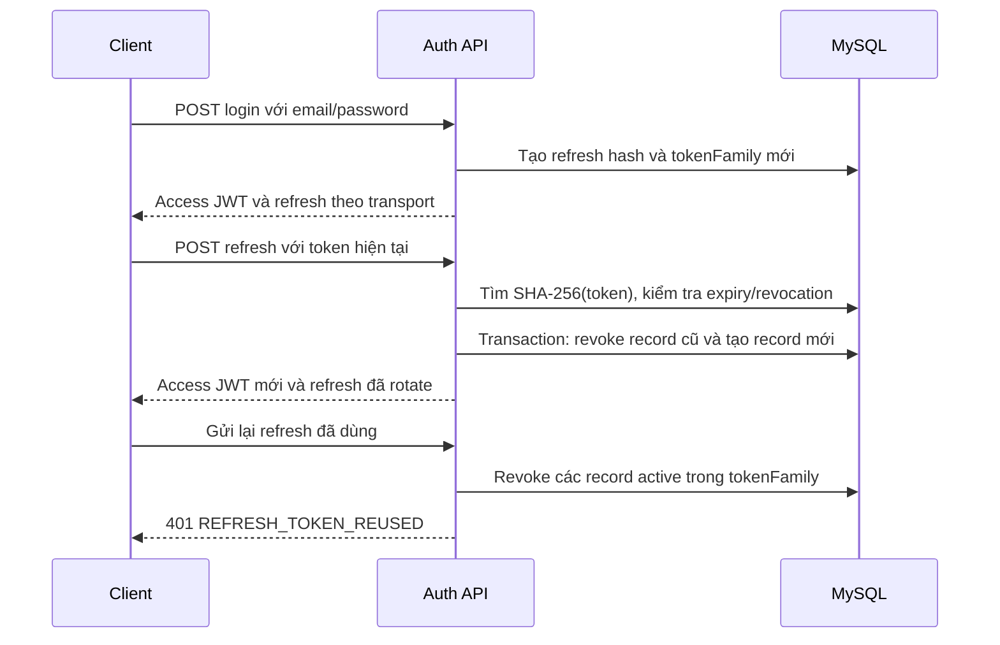

# Authentication & Authorization

> Đối chiếu working tree ngày 2026-10-13. Nguồn: [AuthService](../backend/src/services/auth.service.ts), [AuthController](../backend/src/controllers/auth.controller.ts), [RefreshTokenRepository](../backend/src/repositories/refresh-token.repository.ts), [authenticate](../backend/src/middlewares/auth.ts).

## Cơ chế đăng nhập

MoneyMate dùng access token JWT để xác thực request và refresh token opaque để duy trì phiên. Đăng ký tạo tài khoản với role mặc định `USER`, chưa cấp token; người dùng đăng nhập sau khi đăng ký. Email được trim và chuyển lowercase trong service. Password đăng ký/đổi mật khẩu tối thiểu 8 ký tự; bcrypt dùng 10 salt rounds. Login chỉ yêu cầu password không rỗng, cho phép kiểm tra tài khoản hiện hữu.

| Credential | Cấu trúc / thời hạn | Lưu phía server | Mục đích |
| --- | --- | --- | --- |
| Access token | JWT HS256, 15 phút; claims `userId,email,role` | Không có bảng/token blacklist | Gọi REST private và Copilot runtime |
| Refresh token | 48 random bytes, encode base64url; 7 ngày | SHA-256 hex trong `RefreshToken.tokenHash`, map đến cột SQL `token` | Tạo access token mới và rotation session |

`JWT_ACCESS_SECRET` dùng ký và verify JWT. `JWT_REFRESH_SECRET` vẫn bắt buộc bởi [runtime validation](../backend/src/config/env.ts), nhưng không dùng để ký refresh token trong implementation hiện tại. Production từ chối secret ngắn hơn 32 ký tự hoặc thuộc danh sách example đã biết. Hai secret cần có giá trị độc lập trong cấu hình; không ghi credential thật vào docs/log/repository.

## Web và mobile

| Client | Login | Refresh storage | Refresh request | Response refresh |
| --- | --- | --- | --- | --- |
| Web React | Bỏ platform hoặc `platform:"web"` | Cookie `refreshToken` HttpOnly | POST `/api/auth/refresh`, credentials included | `{accessToken,user}` và cookie mới |
| Mobile iOS/Android | `platform:"ios"/"android"`, metadata tùy chọn | Expo SecureStore | JSON `{refreshToken}`; tránh cookie transport cạnh tranh | `{accessToken,user,refreshToken}` nếu không có cookie request |
| Expo web | `platform:"web"` | HttpOnly cookie; không persist refresh trong JavaScript storage | Credentials included | Như web |

Login luôn set refresh cookie, kể cả mobile, và chỉ trả refresh trong JSON khi platform khác web. Refresh/logout ưu tiên cookie nếu cookie và body cùng tồn tại. Một native client tự lưu cookie nhưng cũng gửi body có thể nhận response không có refreshToken mới; client hiện dùng body transport cho native. Đừng trộn hai nguồn credential.

Cookie có `HttpOnly=true`, `SameSite=Lax`, `Path=/`, `Max-Age=7 ngày`; `Secure=true` khi `NODE_ENV=production`. Clear cookie dùng cùng path/sameSite/secure. Cookie host là API host, không có Domain tùy chỉnh. CORS allowlist không thay đổi SameSite: web/frontend và API ở hai site khác nhau cần cân nhắc topology hoặc reverse proxy; cấu hình hiện tại không chuyển cookie thành `SameSite=None`.

[Web auth store](../frontend/src/stores/auth.store.ts) giữ access token trong RAM và chỉ cache user trong localStorage. [Web API client](../frontend/src/services/api/client.ts) attach Bearer, bật `withCredentials`, chia sẻ một `refreshPromise` cho startup và 401 recovery, đợi refresh đang chạy trước login/logout. Request chỉ retry 401 một lần; auth endpoints không auto retry. Lỗi mạng/5xx khi refresh không tự xóa phiên, trong khi 401/403 mới xóa.

[Mobile storage](../apps/mobile/src/storage/session.ts) dùng SecureStore cho refresh token native với `WHEN_UNLOCKED_THIS_DEVICE_ONLY`, access token ở RAM trong [mobile API client](../apps/mobile/src/lib/api.ts). Native cache user/device để bootstrap; web cache user nhưng refresh token không đọc/ghi qua localStorage. Mobile cũng chia sẻ refreshPromise, chỉ retry request private một lần sau 401 và không refresh lại các path `/auth/*`. Chi tiết offline bootstrap ở [mobile README](../apps/mobile/README.md).

## Rotation và chống reuse

Mỗi login tạo family UUID mới. Refresh token chỉ dùng một lần. [rotate](../backend/src/repositories/refresh-token.repository.ts) cập nhật có điều kiện `revokedAt=null,expiresAt>now` và tạo token con trong cùng DB transaction. Nếu race làm consume thất bại, service revoke family, bao gồm token con vừa được request kia tạo. Client cần serialize refresh và persist token mới trước request refresh tiếp theo; không retry token cũ khi chưa biết request trước đã thành công.

Expiry của token con được tính lại thành 7 ngày từ lúc refresh, giữ nguyên family/device metadata. `lastSeenAt` được cập nhật khi consume và có giá trị mặc định khi record mới tạo. Không trả hash, family hay credential từ session list.

## Logout và quản lý phiên

| Endpoint | Tác dụng |
| --- | --- |
| POST `/api/auth/logout` | Clear cookie ngay, revoke record trùng refresh hash nếu có; không cần Bearer |
| GET `/api/auth/sessions` | Liệt kê record chưa revoke/chưa hết hạn của chính user, theo lastSeenAt giảm dần |
| DELETE `/api/auth/sessions/:id` | Revoke record active thuộc user; 404 nếu không có |
| DELETE `/api/auth/sessions` | Revoke tất cả refresh records active của user |
| PUT `/api/users/change-password` | Kiểm tra mật khẩu cũ, đổi hash và revoke mọi refresh session trong cùng DB transaction |
| DELETE `/api/users/profile` | Kiểm tra password, xóa user cùng dữ liệu quan hệ; dọn file sau DB delete |

Session `id` là ID của **record refresh**, không phải tokenFamily và thay đổi sau rotation. Revoke một ID cũ đã rotate sẽ trả 404. Revoke record ngăn việc renew credential đó; không xóa audit row. Xem mọi input/response trong [API](api.md).

Access token không bị revoke tức thì bởi logout, revoke session, đổi mật khẩu hay đổi role. Middleware verify chữ ký/expiry/claims, không lookup session/user/role trong DB cho mỗi request. Token đã cấp có thể tiếp tục hợp lệ tối đa 15 phút; đổi role chỉ xuất hiện trên token mới sau login/refresh. Xóa account làm mất user và nhiều resource, nhưng không biến JWT hiện hữu thành invalid cryptographically. Đây là giới hạn hiện tại cần biết khi đánh giá session revocation.

## Quyền và sở hữu dữ liệu

REST `authenticate` nhận Bearer trước, rồi fallback cookie `accessToken`. Token phải verify với algorithm allowlist HS256 và có `userId`, `email` kiểu string; nếu role thiếu, default USER. Login không tạo cookie accessToken, nên client chuẩn dùng Bearer. Không dùng localStorage user/role làm bằng chứng quyền server.

`requireAdmin` chặn nếu JWT role khác `ADMIN`. Admin routes quản lý users; self-update qua admin bị chặn toàn bộ, self-delete cũng bị chặn. Đăng ký public không nhận role. Seed chỉ tạo danh mục hệ thống, không tạo tài khoản admin; provision admin là thao tác vận hành riêng, không có password mặc định trong repo.

Services/repositories kiểm tra userId của wallet, transaction, budget, goal, recurring, notification, attachment. Những resource của user khác thường trả 404; attachment delete có trường hợp 403. Category hệ thống có userId null được đọc/sử dụng nhưng không được sửa/xóa. Admin routes chưa có Zod request schema; enum DB chỉ cho `USER/ADMIN`, input sai có thể thành 500.

## Rate limit, CORS và Copilot

Login/register có fixed window limiter theo IP nằm trong memory của từng tiến trình:

| Loại | Mặc định | Biến cấu hình |
| --- | --- | --- |
| Login | 10 request / 900000 ms | `AUTH_LOGIN_RATE_LIMIT_MAX`, `AUTH_LOGIN_RATE_LIMIT_WINDOW_MS` |
| Register | 5 request / 3600000 ms | `AUTH_REGISTER_RATE_LIMIT_MAX`, `AUTH_REGISTER_RATE_LIMIT_WINDOW_MS` |

Trả `RateLimit-Limit`, `RateLimit-Remaining`, `RateLimit-Reset` (Unix seconds); vượt giới hạn trả 429 `AUTH_RATE_LIMITED` và `Retry-After`. Limiter đếm cả request validation thất bại. Restart xóa counters; nhiều replica không chia sẻ counters. App production đặt `trust proxy=1`; cần reverse proxy phù hợp để IP không bị diễn giải sai.

REST CORS `credentials=true`; production chỉ cho exact origins trong `FRONTEND_URL` sau trim/trailing-slash normalization. Request không có Origin được cho phép; CORS là policy browser, không thay authorization. Development còn cho HTTP localhost/127.0.0.1/host LAN được khai báo trong source ở mọi port. Không có CSRF-token middleware chung; cookie refresh hiện dựa vào SameSite và cách triển khai browser.

[Copilot auth](../backend/src/copilotkit/auth.ts) chỉ dùng Bearer. [Copilot security](../backend/src/copilotkit/security.ts) check exact origin cả development, production yêu cầu HTTPS, limit payload 64kb và message; bind threadId với user trong RAM. Runtime chặn memories/thread management/debug endpoints, chỉ server financial tools read-only và không forward system/developer messages của client. Các frontend mutation tools vẫn đi qua REST ownership/validation sau xác nhận. Xem [API runtime](api.md#ai-rest-và-copilotkit).

## Kiểm thử và vận hành

Nguồn kiểm thử: [auth unit tests](../backend/src/__tests__/unit/auth.service.test.ts), [controller tests](../backend/src/__tests__/unit/auth.controller.test.ts), [integration auth](../backend/src/__tests__/integration/auth.api.test.ts), [API client tests](../frontend/src/services/api/__tests__/client.test.ts).

Khi thay đổi cơ chế phiên, kiểm tra ít nhất login web/native, refresh liên tiếp, refresh đồng thời/replay, logout khi DB revoke lỗi, revoke một/tất cả phiên, đổi password, request 401 đến muộn và lỗi mạng tạm thời. Backend integration auth cần DB test riêng. Không dùng production DB cho kiểm thử.

Migration [secure_multi_device_sessions](../backend/prisma/migrations/20260822090000_secure_multi_device_sessions/migration.sql) hash token hiện có tại chỗ, thêm family/device/revocation fields. Rollback backend về phiên bản dùng token thô sau migration này làm phiên cũ không tương thích; cần xử lý deploy đồng bộ hoặc buộc login lại. Refresh records hiện chưa có job tự purge, nên cần quy trình retention được xác định riêng nếu triển khai lâu dài.

Xem [thiết lập môi trường](environment-setup.md), [database](erd.md), [nghiệp vụ](business_rules.md), [deployment](deployment.md).
