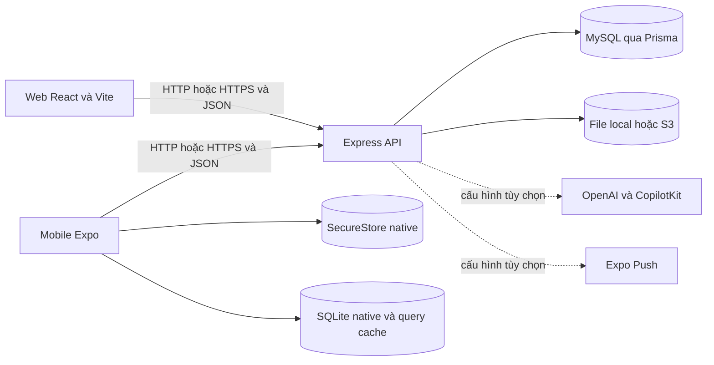
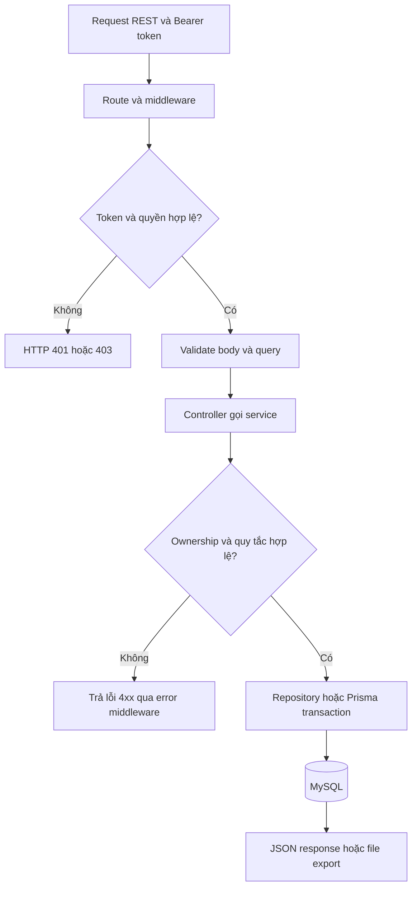
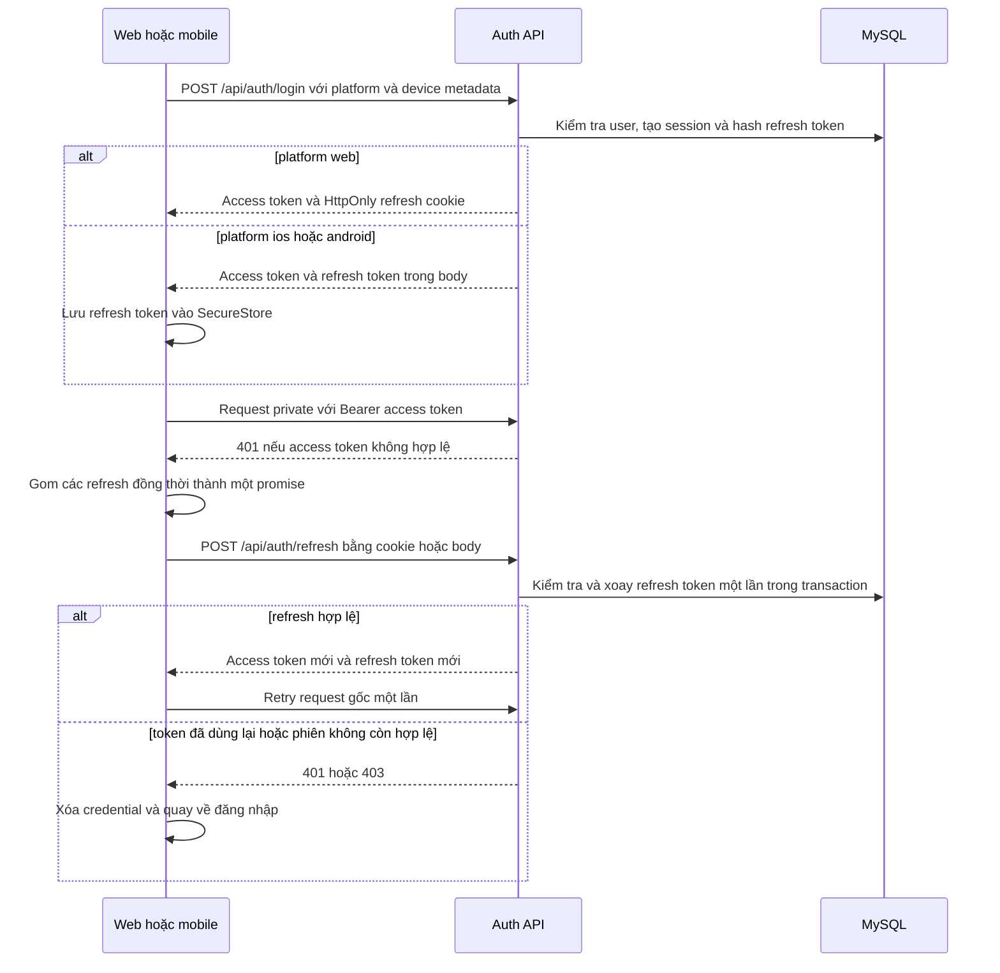
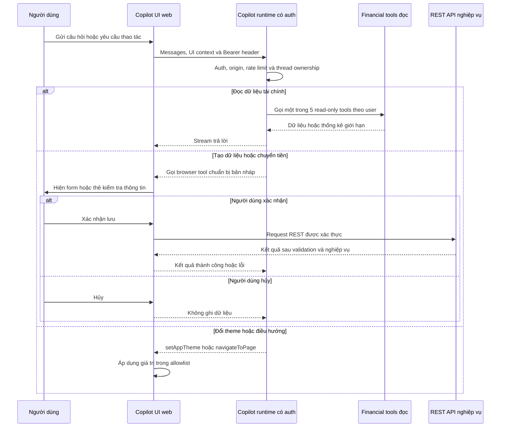
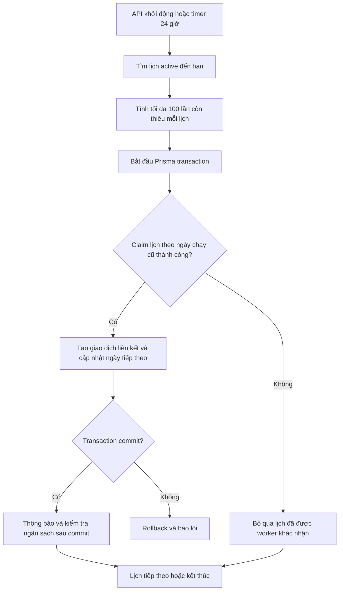
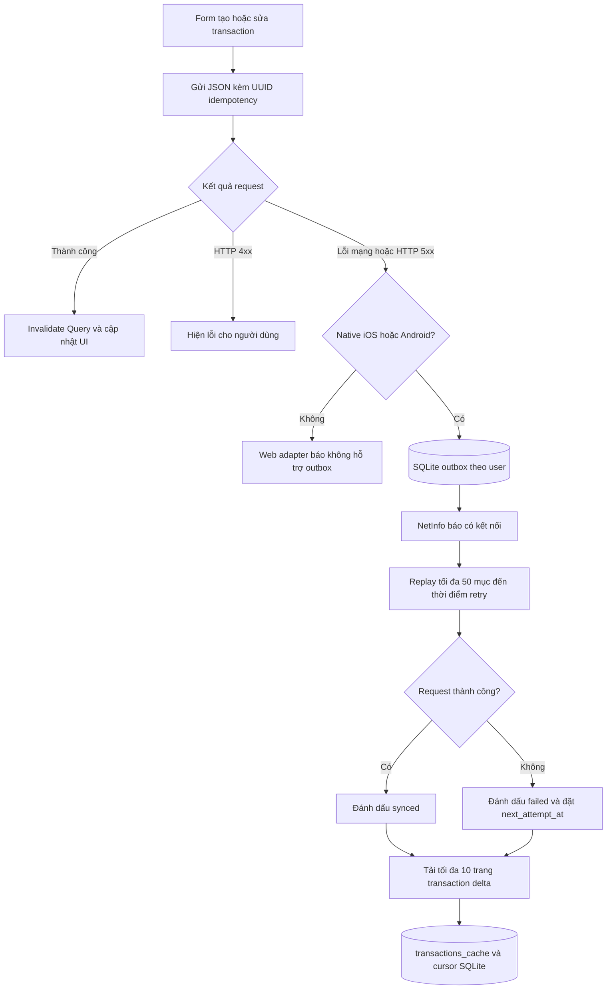
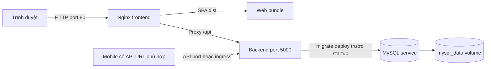

# Sơ đồ hệ thống

> Dựa trên mã nguồn trong worktree ngày 2026-10-13. Các sơ đồ mô tả luồng đã có trong source; cấu hình môi trường và kiểm thử runtime xem [kiến trúc](architecture.md), [testing](testing.md) và [deployment](deployment.md).

## 1. Thành phần runtime

MySQL là dữ liệu server chính. SQLite trên mobile lưu cache/outbox; không kết nối trực tiếp MySQL. HTTPS cần ingress/cấu hình triển khai phù hợp, Compose mặc định chỉ mở HTTP.

## 2. Request tài chính

Các endpoint dùng idempotency kiểm tra `Idempotency-Key` sau auth; endpoint cập nhật/xóa transaction còn kiểm tra `version`. Không phải mọi endpoint đều có cùng chuỗi middleware. Xem [API](api.md).

## 3. Phiên web và native

Refresh token không lưu plaintext trong MySQL. Nhánh phát hiện reuse có cơ chế thu hồi token family. Lỗi mạng/5xx khi refresh có cách xử lý khác lỗi xác thực; đọc [auth sessions](auth_sessions.md) để biết TTL và điều kiện thu hồi.

## 4. Web Copilot và xác nhận ghi dữ liệu

Browser write tools gồm `recordExpense`, `recordIncome`, `transferFunds`, `createCategory`, `createWallet`, `createBudget`, `createSavingGoal`, `createRecurringTransaction`. Backend financial tools đọc không trực tiếp ghi DB. Mobile chatbot dùng REST `/ai/chat`, không dùng luồng browser tools này.

## 5. Recurring transaction

Timer nằm trong tiến trình API. Claim ở DB giảm việc tạo trùng giữa các lượt đồng thời, nhưng cấu hình này chưa có scheduler/worker riêng. Quy tắc ngày và số dư xem [business rules](business_rules.md).

## 6. Mobile outbox hiện tại

Ảnh attachment không nằm trong outbox. Delete/transfer chưa đi qua queue này. Backoff chỉ lưu thời điểm retry; chưa có timer replay độc lập hoặc UI xử lý conflict. Delta chưa được nối làm nguồn hiển thị của màn hình giao dịch và replay chưa invalidate Query cache. Đọc [mobile README](../apps/mobile/README.md) trước khi mô tả ứng dụng là offline-first.

Idempotency middleware bảo vệ POST tạo transaction/transfer, PUT sửa và DELETE giao dịch trong thời hạn record 24 giờ; PUT/DELETE vẫn kiểm tra `version` và DELETE đưa query version vào hash. Không hiểu mũi tên replay là bảo đảm exactly-once vô thời hạn cho mọi thao tác.

## 7. Docker Compose

API `/health` hiện dùng port backend; Nginx không proxy đường dẫn này. TLS, backup và lưu bền file upload cần bổ sung trong môi trường deploy. CI Docker smoke kiểm tra health, SPA và 401 của route private; đây không phải kiểm thử end-to-end trên thiết bị hoặc xác nhận production.
