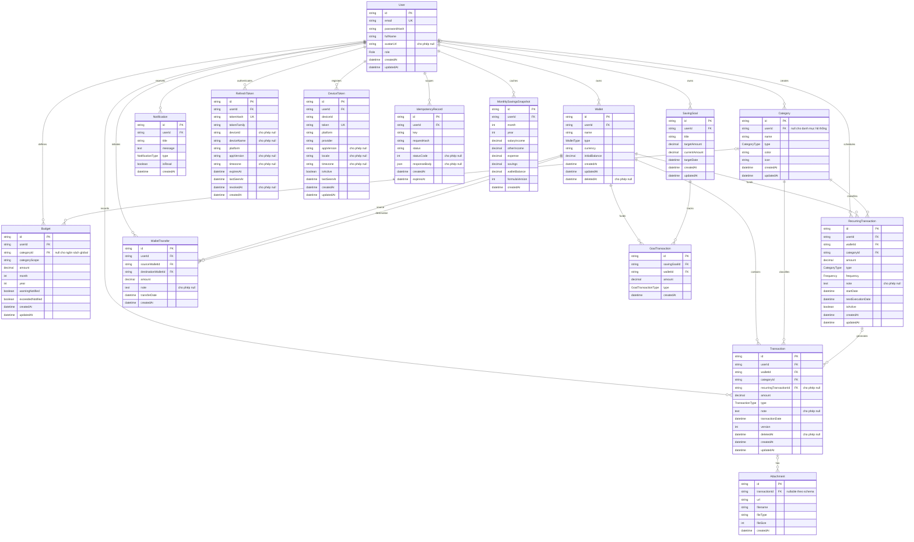

# Thiết kế database MoneyMate

> Đối chiếu working tree ngày 2026-10-13. Nguồn chuẩn: [schema.prisma](../backend/prisma/schema.prisma) và [migrations](../backend/prisma/migrations). Database provider là MySQL; client được sinh bởi Prisma 5.

## ERD

PK là khóa chính, FK là khóa ngoại, UK là unique. Mọi ID có Prisma default UUID (string); các quan hệ có đầu `o|` cho phép FK null. Diagram dùng tên Prisma model, tên bảng SQL ở bảng mô tả bên dưới.



## Entity và trách nhiệm

| Model / bảng SQL | Trách nhiệm | Trường chính / giá trị mặc định |
| --- | --- | --- |
| User / `users` | Tài khoản và chủ sở hữu | email unique, passwordHash, fullName, avatarUrl nullable, role=USER |
| Wallet / `wallets` | Ví và số dư mutable hiện tại | type, currency=VND, initialBalance=0, deletedAt nullable |
| Category / `categories` | Phân loại thu/chi | userId null cho global, color=#CCCCCC, icon=tag |
| Transaction / `transactions` | Ghi nhận thu/chi và audit chuyển ví | wallet/category bắt buộc, amount, type, transactionDate, version=1, deletedAt null; recurringTransactionId tùy chọn |
| Budget / `budgets` | Giới hạn global/category mỗi tháng | categoryId nullable, categoryScope=GLOBAL, amount, month/year, hai cờ alert=false |
| SavingGoal / `saving_goals` | Tiền dành cho mục tiêu | targetAmount, currentAmount=0, targetDate; status/progress tính trong service |
| GoalTransaction / `goal_transactions` | Lịch sử nạp/rút goal | goal/wallet, amount, type DEPOSIT/WITHDRAW |
| RecurringTransaction / `recurring_transactions` | Mẫu recurring và execution cursor | frequency, startDate, nextExecutionDate, isActive=true |
| Notification / `notifications` | Inbox trong ứng dụng | title/message/type, isRead=false |
| RefreshToken / `refresh_tokens` | Record refresh rotation/session | tokenHash map cột `token` VARCHAR(64), tokenFamily, metadata thiết bị, revokedAt nullable |
| DeviceToken / `device_tokens` | Thiết bị Expo push | token unique, deviceId/platform, provider=expo, isActive=true, metadata locale/timezone |
| IdempotencyRecord / `idempotency_records` | Dedup request create transaction/transfer | key≤100, requestHash 64, status=PENDING, statusCode/responseBody nullable, expiresAt |
| WalletTransfer / `wallet_transfers` | Một lần chuyển giữa 2 ví | source/destinationWalletId, amount, transferDate; note nullable |
| MonthlySavingsSnapshot / `monthly_savings_snapshots` | Kết quả tổng hợp tháng có thể recompute | income components, expense/savings, walletBalance=0, formulaVersion default6; application hiện ghi9 |
| Attachment / `attachments` | Metadata file của transaction | transactionId nullable theo schema, storage url, filename/fileType/fileSize; API upload luôn liên kết transaction |

Các model có createdAt default now; User/Wallet/Category/Transaction/Budget/SavingGoal/RecurringTransaction/DeviceToken có updatedAt do Prisma `@updatedAt`. RefreshToken/DeviceToken có lastSeenAt default now. MonthlySavingsSnapshot chỉ có createdAt, không có updatedAt. Monetary columns dùng `DECIMAL(15,2)`; note/message dùng TEXT khi được chỉ định, IdempotencyRecord.responseBody dùng JSON. Các FK string của schema hiện phần lớn là VARCHAR(191), không phải binary UUID.

## Enum

| Enum | Giá trị |
| --- | --- |
| Role | USER, ADMIN |
| WalletType | CASH, BANK, CREDIT_CARD, E_WALLET, SAVING |
| CategoryType | INCOME, EXPENSE |
| TransactionType | INCOME, EXPENSE, TRANSFER |
| GoalTransactionType | DEPOSIT, WITHDRAW |
| Frequency | DAILY, WEEKLY, MONTHLY, YEARLY |
| NotificationType | BUDGET_ALERT, BILL_REMINDER, GOAL_COMPLETED, RECURRING_TRANSACTION |

`platform/provider/status` trong RefreshToken, DeviceToken, IdempotencyRecord là string DB, không phải enum Prisma. API validators hạn chế platform/provider ở request; thao tác DB trực tiếp không được những validators đó bảo vệ.

## Unique và indexes

| Entity | Ràng buộc / index khai báo trong schema | Mục đích |
| --- | --- | --- |
| User | unique email | Một email cho một tài khoản |
| Category | unique `(userId,name,type)` | Danh mục riêng không trùng name/type; MySQL nullable userId không bảo đảm global unique |
| Budget | unique `(userId,categoryScope,month,year)` | Ngăn trùng scope, kể cả global |
| MonthlySavingsSnapshot | unique `(userId,month,year)` | Một kết quả tháng/user |
| RefreshToken | unique tokenHash; index `(userId,revokedAt)`, tokenFamily | Lookup credential và revoke phiên/family |
| DeviceToken | unique token; unique `(userId,deviceId,provider)`; index `(userId,isActive)` | Physical token không thuộc hai user cùng lúc, truy vấn push active |
| IdempotencyRecord | unique `(userId,key)`; index expiresAt | Dedup theo user và tra thời hạn |
| Wallet | index `(userId,deletedAt)` | Truy vấn ví active/archived |
| Transaction | index `(userId,updatedAt)`, `(userId,deletedAt,transactionDate)`, `(recurringTransactionId,transactionDate)` | Sync, báo cáo, loại recurring projection đã sinh |
| RecurringTransaction | index `(isActive,nextExecutionDate)` | Scheduler tìm due |

Migration lịch sử và MySQL FK cũng có thể tạo/giữ index đơn cho quan hệ. Danh sách trên là các unique/index được khai báo rõ trong schema hiện tại; không thay thế kiểm tra execution plan và index thực tế production.

`categoryScope` được repository đồng bộ theo categoryId: null → GLOBAL, có ID → ID. Migration giữ scope `LEGACY:<id>` cho budget global cũ để không xóa dữ liệu trùng lịch sử. Không sửa categoryId trực tiếp trong SQL mà bỏ qua scope.

## Quan hệ và vòng đời xóa

- User → ví/category/transaction/budget/goal/recurring/notification/refresh/device/idempotency/transfer/snapshot dùng Cascade.
- Transaction → wallet và category dùng Restrict; physical delete wallet/category bị chặn khi còn record tham chiếu.
- RecurringTransaction → wallet/category dùng Restrict.
- GoalTransaction → wallet dùng Restrict; → savingGoal dùng Cascade.
- WalletTransfer → source/destinationWallet dùng Restrict.
- Budget → category dùng Cascade; category nullable cho global.
- Transaction → recurringTransaction dùng SetNull: xóa lịch không xóa transaction đã sinh.
- Attachment → transaction dùng Cascade: xóa vật lý transaction xóa metadata, không tự xóa object storage ở mức DB.

API DELETE Wallet và Transaction là soft delete, không kích hoạt FK cascade của physical delete. Archive wallet tắt recurring cùng ví và giữ transaction/transfer/goal history. Xóa transaction thường chỉ tạo tombstone và giữ attachments; các API attachment kiểm tra transaction active nên không phục vụ file của transaction đã xóa. Account/admin user delete dùng physical user delete, sau đó dọn object storage ở service.

DB FK bảo vệ existence nhưng không chứng minh các userId của mọi quan hệ giống nhau. Ownership, category type, amount>0, future transactionDate và balance guards nằm trong service/validator hoặc write có điều kiện, không được schema diễn đạt đầy đủ. Không có CHECK constraint chung bảo đảm Wallet.initialBalance/currentAmount luôn không âm; đảo INCOME hiện có thể âm. Xem [nghiệp vụ](business_rules.md).

## Lịch sử migrations

Tên migration là định danh trong repository, không khẳng định ngày production đã deploy. Thực tế database đã áp dụng những migration nào cần kiểm tra `prisma migrate status` và `_prisma_migrations`.

| Migration | Nội dung |
| --- | --- |
| [20250626000000_init](../backend/prisma/migrations/20250626000000_init/migration.sql) | Các bảng tài khoản, ví, giao dịch, category, budget, goal, recurring, notification, refresh, transfer, attachment và FK |
| [20260629000001_add_role](../backend/prisma/migrations/20260629000001_add_role/migration.sql) | Role USER/ADMIN |
| [20260629013751_link_wallets_to_users](../backend/prisma/migrations/20260629013751_link_wallets_to_users/migration.sql) | Chuẩn hóa ID/FK sang VARCHAR(191), tái lập FK/index theo naming Prisma |
| [20260806000000_add_monthly_savings_snapshots](../backend/prisma/migrations/20260806000000_add_monthly_savings_snapshots/migration.sql) | Bảng snapshot và unique tháng/user |
| [20260806010000_recalculate_monthly_savings_snapshots](../backend/prisma/migrations/20260806010000_recalculate_monthly_savings_snapshots/migration.sql) | Thêm formulaVersion cho dữ liệu cũ |
| [20260822090000_secure_multi_device_sessions](../backend/prisma/migrations/20260822090000_secure_multi_device_sessions/migration.sql) | Hash refresh tokens tại chỗ, family, metadata, lastSeenAt/revokedAt và indexes |
| [20260822100000_add_devices_and_idempotency](../backend/prisma/migrations/20260822100000_add_devices_and_idempotency/migration.sql) | DeviceToken và IdempotencyRecord |
| [20260822110000_add_transaction_sync_metadata](../backend/prisma/migrations/20260822110000_add_transaction_sync_metadata/migration.sql) | Transaction version/deletedAt và user-updatedAt index |
| [20260903000000_fix_monthly_savings_formula](../backend/prisma/migrations/20260903000000_fix_monthly_savings_formula/migration.sql) | FormulaVersion default5 |
| [20260903010000_harden_budget_uniqueness](../backend/prisma/migrations/20260903010000_harden_budget_uniqueness/migration.sql) | categoryScope, unique không nullable, alert dedupe flags; bảo toàn legacy global budgets |
| [20260904010000_link_recurring_and_seed_categories](../backend/prisma/migrations/20260904010000_link_recurring_and_seed_categories/migration.sql) | Transaction recurring link/index và provision 14 global categories cho migrate deploy |
| [20260905000000_add_wallet_balance_to_snapshot](../backend/prisma/migrations/20260905000000_add_wallet_balance_to_snapshot/migration.sql) | walletBalance snapshot, formulaVersion default6 |
| [20260905010000_add_report_scheduler_indexes](../backend/prisma/migrations/20260905010000_add_report_scheduler_indexes/migration.sql) | Composite index báo cáo và scheduler due |
| [20260922000000_soft_delete_wallets](../backend/prisma/migrations/20260922000000_soft_delete_wallets/migration.sql) | Wallet.deletedAt và user-deletedAt index |

## Phát triển và triển khai schema

Chạy từ root repository sau khi cài workspace dependencies và cấu hình backend environment:

```bash
npm run prisma:generate --workspace=moneymate-backend
npm run prisma:migrate --workspace=moneymate-backend
npm run prisma:seed --workspace=moneymate-backend
```

Tạo thay đổi schema bằng **migration mới**, review SQL và thử trên DB development/test. Không sửa migration đã deploy để đổi lịch sử. Prisma migrate dev dành cho development; seed riêng chỉ thêm category hệ thống và không tạo tài khoản/admin.

Production dùng `prisma migrate deploy` từ backend, như [Dockerfile](../backend/Dockerfile) trước khi start server. Không dùng migrate reset/db push để thay migration production. Trước thay đổi destructive hoặc hash/schema compatibility, cần backup DB và kiểm chứng restore, cùng kế hoạch deploy ứng dụng tương thích. Object storage backup tách riêng DB backup.

Schema/version không chứng minh DB thật đã sẵn sàng. `GET /health` không query database; dùng migrate status và thao tác API cần DB để kiểm tra readiness. Xem [environment setup](environment-setup.md), [deployment](deployment.md), [API](api.md), [authentication](auth_sessions.md).
